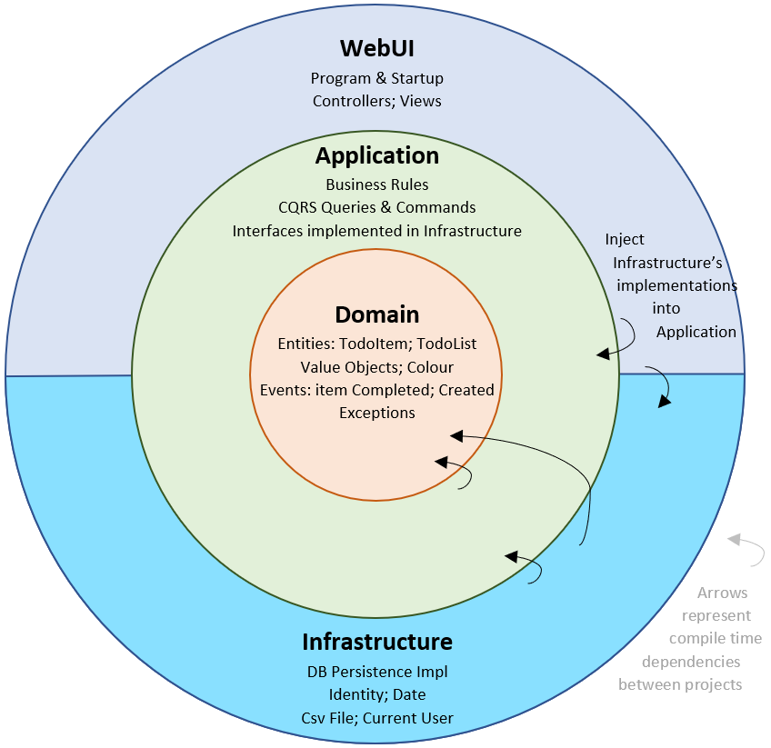
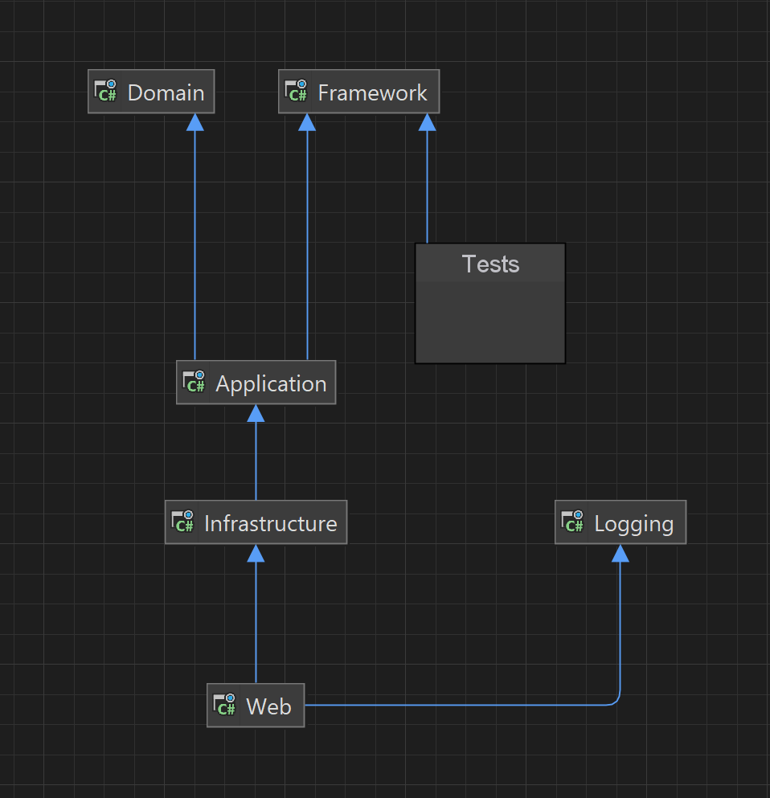

# Architektura

Solution je postaveny s velkym durazem na separation of concerns, konkretne je pouzity navrh tzv. `clean architecture`.

Clean architecture se sklada z nekolika casti, kazda tahle cast odpovida separatnimu projektu:

## Domain
tady jsou nadefinovane samotne *BUSINESSOVE* entity se kteryma pracujeme -  muze to byt User, Device, Enterprise, Invoice atd...

## Application
obsahuje samotnou business logiku - ta je implementovana v takzvanych `Services`. take drzi Interface tedy kontrakt pro kazdou tuhle Servicu.

#### Duvod/Vyhody:
muze se stat, ze chceme z jakehokoliv duvodu v budoucnu zmenit vnitrek business logiky. Ted staci vymenit samotnou implementaci za jakoukoliv jinou, ktera splnuje ten stejny kontrakt. pak zbyva jenom novou Servicu registrovat do Dependency Injection kontejneru a zbytek celeho systemu bezi dale jak doted.

***

Dale tu jsou interfacy `I{BusinessEntita}Repository`. Ty urcuji kontrakt jakym zpusobem si aplikace, tedy business vrstva fetchuje data nad kteryma samotnou business logiku provadi.

#### Duvod/Vyhody:
podobne jako predtim, muzeme vymenit zdroj odkud se data berou - misto napriklad sql serveru budeme volat externi API. Pro zmenu staci jenom aby zdroj dat splnoval tento kontrakt, zbytek systemu to opet nijak neovlivni. 

***

## Infrastructure
Predstavuje jakekoliv externi zdroje - SQL Server, API,..

Zaroven tady jsou samotne `{BusinessEntita}Repository` tj. implementace `I{BusinessEntita}Repository` kontraktu, ktery si definovala samotna aplikacni vrstva. Ty urcuji jak samotne data ziskat - v nich bude kod, ktery napriklad vola zminene externi API, nebo dela requesty do databaze.

#### Duvod/Vyhody:
Zas a znova - rozhodnu se vymenit SQL za napriklad MongoDB? staci vymenit implementaci `Repository` na tomto miste. 

## Web
Nekdy se tomu taky rika prezentacni vrstva - tady najdeme jak webove UI, tak API endpointy ktere nase aplikace exposuje.

## Clean Architecture diagram:

***

# Nas Solution:
Ted popojedeme od obecneho konceptu clean architecture k nasemu konkretnimu solutionu, ktery ji vyuziva

(V Rideru) Tools > Architecture > Show Project Diagram:

Diagram ukazuje zavislosti mezi jednotlivymi projekty.

!! cemu se chceme za kazdou cenu vyhnout jsou circular dependencies !!

***

Oproti zakladnimu clean architecture tu mame navic `Framework`, `Logging` a `Tests`:

 ## Framework
 Da se na to divat jako na nas framework pro konkretni solution, ve smyslu ze tu mame veci jako nas tooling - v nasem pripade ruzne extension metody nebo treba vlastni Option type ke kteremu se dostanu pozdeji.

## Logging
samotna .Net core appka bezi nekde v azuru na serveru v Nizozemsku a my potrebujeme vedet co se s ni sakra deje. Od toho mame loggovani - za behu posilame informace do `Seq`, odkud uz muzeme zjistovat jak dlouho napriklad volani konkretniho endpointu trvalo zpracovat.

## Tests
Kazdy system aby zustal na trhu relevantni se musi vyvijet a menit. To aby provest samotnou zmenu byl minimalni problem zajistuje uz popsana architektura. Kazda takova zmena ale prinasi potencialni riziko rozbiti doted fungujici casti. Proto na hranici `Domain` a `Application` piseme unit testy, a na rozhrani `Application` a `Infrastructure` piseme testy integracni - ty sahaji uz i do databaze. V pipeline potom nelze provest merge bez toho ani by vsechny testy byly uspesne dokoncene a minimalizovalo se tak riziko problemu.

Dalsi moznost jsou jeste E2E (end to end) testy s ruznyma automatickyma klikatkama ktere testuji i klikani v prohlizeci atd.

***

## Ted zpatky projedme jednotlive casti `clean architecture`, ale tentokrat detailneji a s tim co tam mame pouzite my a proc:

### Application
Predtim jsem zminil ze tady je business logika nejakym zpusobem schovana v `Services`.

Takova `DeviceService` napriklad muze mit metodu pro update *Device*, ktera se jmenuje rekneme 

`UpdateDevice(Guid id)`

Tady bude v te metode implementovane, co vsechno ten samotny update zarizeni znamena.
V praxi to muze vypadat tak, ze existuji privatni metody pro jednotlive dilci casti, a ty jsou:

*  To zarizeni s danym id vubec musi existovat - je ulozene v DB?
*  Je zarizeni vubec dostupne? Da se na nej po siti dobouchat?
*  Zjisteni verze firmwaru na danem mikrokontroleru
*  Jaka je nejaktualnejsi verze firmwaru?
*  ... atd

Tyhle dilci casti budou pravdepodobne predstavovat privatni metody, ktere budou sdilene napric mnoha takhle exposnutymi public metodami jako je prave tahle `UpdateDevice(Guid id)`. Dulezite je, aby byl testovatelny integrakama nejen cely kontrakt - tj. samotna Update metoda, ale idealne pokud to dava smysl i zminene dilci casti unit testama.

Obecne si lze predstavit ze kazda public metoda `Service` je jakasi "Customer story" - uzivatel chce zmenit nastaveni mikrokontroleru? Nejspis budeme chtit vytvorit metodu, ktera bude vypadat priblizne takhle: `UpdateDeviceSetting(DeviceSettings settings)`. To co se deje na pozadi uz je zalezitosti te samotne metody.

(Nakonec i v UI to bude vypadat tak, ze se budou volat prave tyhle exposunute metody `Services`)

### Infrastructure

V nasem pripade tady je definice databazoveho schema (pouzivame tzv. `code first approach`)

***

Take je dulezita vec fakt, ze kazdy Business objekt ma svuj protejsek - Database objekt.

Napr: `Device` (vyuzivany v business logice) X `DeviceEntity` (urcuje jak vypada db tabulka Device)

Ten duvod proc prave takhle, je jednoduchy - v databazi si muzu ulozit DeviceEntity jakym zpusobem chci, ale samotna repository (to co urcuje jak ziskavam data) bude vracet `Device`.

Taky se na to da divat stylem - "muzu si to skladovat jak chci, staci kdyz ze svych dat jsem schopny namapovat business entity".

Vysledna flow potom vypada nasledovne:

* `DeviceService` zavola `DeviceRepository`, aby ji vratila vsechny `Devices` v tabulce.
* `DeviceRepository` udela request do sql databaze, odkud se ji vrati kolekce `DeviceEntity`.
* `DeviceRepository` namapuje kazdou `DeviceEntity` na businessovy `Device` a to vrati `DeviceService` jako vysledek

#### Duvod/Vyhody:
Prestoze v drtive vetsine pripadu budou obe entity 1:1 stejne, muze se stat ze bude potreba napriklad v business vrstve mit nejake informace pribalene navic, ktere bysme ale nechteli skladovat v db.

Dalsi priklad co muze nastat je ze v ramci toho ze chceme dorucovat male pull requesty na ktere se snadno dela review, muzeme si v jednom pr pouze nachystat entity a v dalsim pr napsat samotnou implementaci. Pokud ale pouzivame automaticke rutimove migrace a hlavne business entita je i databazova, po mergi prvniho pr se nam zmeni schema, ale my si muzeme pozdeji uvedomit, ze bysme potrebovali business kontrakt namodelovat jinak - v ten moment ale mame uz spatne sloupce v tabulce a ceka nas hromada bolesti. (Been there, done that.)

(tldr: proste nikdy nepouzivej business entitu zaroven jako databazovou.)