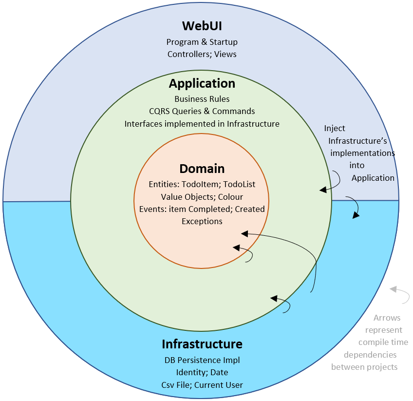
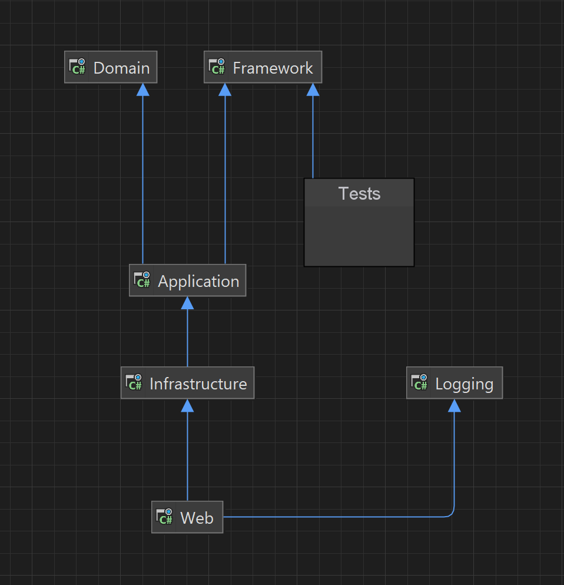

# Architektura

Solution je postavený s velkým důrazem na separation of concerns, konkrétně je použitý návrh tzv. `clean architecture`.

Clean architecture se skládá z několika částí, každá tahle část odpovídá separátnímu projektu:

## Domain
Zde jsou nadefinované samotné *BUSINESSOVÉ* entity, se kterými pracujeme - může to být User, Device, Enterprise, Invoice atd...

## Application
Obsahuje samotnou business logiku - ta je implementovaná v tzv. `Services`. Také drží Interface neboli kontrakt pro každou `Service`.

#### Důvod/Výhody:
Může se stát, že chceme z jakéhokoliv důvodu v budoucnu změnit obsah business logiky. Nyní stačí vyměnit pouze samotnou implementaci za jakoukoliv jinou, která splňuje stejný kontrakt. Pak zbývá jen novou Service registrovat do Dependency Injection kontejneru a zbytek celého systému běží nadále jak doteď.

***

Dále jsou zde interfaces `I{BusinessEntita}Repository`. Ty určují kontrakt jakým způsobem si aplikace, tedy business vrstva, fetchuje data nad kterýma samotnou business logiku provádí.

#### Důvod/Výhody:
Podobně jako předtím můžeme vyměnit zdroj odkud se data berou - namísto například SQL serveru budeme volat externí API. Pro změnu stačí pouze aby zdroj dat splňoval tento kontrakt, zbytek systému to opět nijak neovlivňí.

***

## Infrastructure
Představuje jakékoli externí zdroje - SQL Server, API,..

Zároveň tady jsou samotné `{BusinessEntita}Repository` tj. implementace `I{BusinessEntita}Repository` kontraktu, který si definovala samotná aplikační vrstva. Ty určují, jak samotné data získat - bude v nich kód, který například volá zmíněné externí API nebo dělá requesty do databáze.

#### Důvod/Výhody:
Jako výše jde o to mít možnost jednoduše změnit tuto část bez ovlivnění zbytku kódu. Rozhodnu se vyměnit SQL za např. MongoDB? Stačí vyměnit implementaci `Repository` na tomto místě. 

## Web
Někdy také prezentační vrstva - tady najdeme jak webové UI, tak API endpointy které naše aplikace exposuje.

## Clean Architecture diagram:

***

# Náš Solution:
Teď popojedeme od obecného konceptu clean architecture k našemu konkrétnímu solutionu, který ji využívá

(V Rideru) Tools > Architecture > Show Project Diagram:

Diagram ukazuje závislosti mezi jednotlivými projekty.

!! Za každou cenu se chceme vyhnout circular dependencies !!

***

Oproti základnímu clean architecture tu máme navíc `Framework`, `Logging` a `Tests`:

 ## Framework
 Dá se na to dívat jako na náš framework pro konkrétní solution, ve smyslu že tu máme věci jako náš tooling - v našem případě různé extension metody nebo třeba vlastní Option, který bude zmíněn později.

## Logging
Samotná .Net core aplikace běží v Azure na serveru v Nizozemsku a je potřeba vědět, co se s ní děje. Od toho mame loggování - za běhu posíláme informace do `Seq`, odkud již můžeme zjišťovat, jak dlouho např. volání konkrétního endpointu trvalo zpracovat.

## Tests
Každý systém se musí vyvíjet a měnit aby zůstal na trhu relevantní. To, aby provedení samotné změny byl minimální problém zajišťuje už popsaná architektura. Každá taková změna ale přináší potenciální riziko rozbití doteď fungující části. Proto na hranici `Domain` a `Application` píšeme unit testy, a na rozhraní `Application` a `Infrastructure` píšeme testy integrační - ty již sahají i do databáze. V pipeline potom nelze provést merge dokud všechny testy nejsou úspěšně dokončeny. Tím se minimalizuje riziko problému.

Další možnost jsou ještě E2E (end to end) testy, které testují i klikání v prohlížeči atd.

***

## Teď zpětně projdeme jednotlivé části `clean architecture`, ale detailněji s tím co tam máme použité my a proč:

### Application
Již byla zmíněna bussiness logika schovaná v `Services`.

Taková `DeviceService` např. může mít metodu pro update *Device*, která se může jmenovat `UpdateDevice(Guid id)`. 
V této metodě bude implementované vše, co znamená samotný update zařízení.

V praxi to může vypadat tak, že existují privátní metody pro jednotlivé dílčí části:

*  Zařízení s daným id musi existovat - je uložené v DB?
*  Je zařízení dostupné? Je možné s ním komunikovat?
*  Zjišťění verze firmwaru na daném mikrokontroleru
*  Zjišťění nejaktuálnější verze firmwaru?
*  ... atd

Tyto dílčí části budou pravděpodobně představovat privátní metody, které budou sdílené napříč mnoha exposed public metodami jako je právě `UpdateDevice(Guid id)`. Důležité je, aby byl nejen celý kontrakt testovatelný integračními testy - tj. samotná Update metoda, ale ideálně mít i jednotlivé dílčí části pokryté unit testy.

Obecně si lze představit každou public metodu `Service` jako nějakou "Customer story" - uživatel chce změnit nastavení mikrokontroleru? Nejspíš budeme chtít vytvořit metodu, která bude vypadat přibližně takhle: `UpdateDeviceSetting(DeviceSettings settings)`. To co se děje na pozadí je již záležitostí samotné metody.

(Nakonec i v UI to bude vypadat tak, že se budou volat právě tyto exposed metody `Services`)

### Infrastructure

V našem případě je zde definice databázového schéma (používáme tzv. `code first approach`)

***

Také je důležité, že každý Business objekt má svůj protějšek - Database objekt.

Např: `Device` (využíván v business logice) **X** `DeviceEntity` (určuje, jak vypadá db tabulka Device)

Díky tomuto si lze v databázi uložit `DeviceEntity` jakýmkoli způsobem, ale samotná repository (to co určuje způsob získávání dat) bude vracet `Device`.

Laicky řečeno - *"můžu si to skladovat jak chci, stačí když jsem ze svých dat schopný namapovat business entity"*.

Výsledný postup potom vypadá následovně:

* `DeviceService` zavolá `DeviceRepository`, aby jí vrátila všechny `Devices` v tabulce.
* `DeviceRepository` udělá request do SQL databáze, odkud se jí vrátí kolekce `DeviceEntity`.
* `DeviceRepository` namapuje každou `DeviceEntity` na businessový `Device` a to vrátí `DeviceService` jako výsledek

#### Důvod/Výhody:
Může se stát, že bude potřeba např. v business vrstvě mít nějaké informace přibalené navíc, které bychom ale nechtěli skladovat v databázi, byť velmi častým případem bude, že obě entity mají totožné properties.

Také si v rámci doručování malých pull requestů, na které se snadno dělá review můžeme v jednom pr pouze nachystat entity a v dalším pr napsat samotnou implementaci. Pokud ale používáme automatické runtime migrace anebo je business entita zároveň i databázová, po mergi prvního pr se nám změní schéma, ale my si můžeme později uvědomit, že bychom potřebovali business kontrakt namodelovat jinak - v ten moment ale již máme špatně sloupce v tabulce a čeká nás hromada nepříjemností při měnení sloupců databáze. (Been there, done that.)

(tldr: nepoužívat business entitu zároveň jako databázovou.)